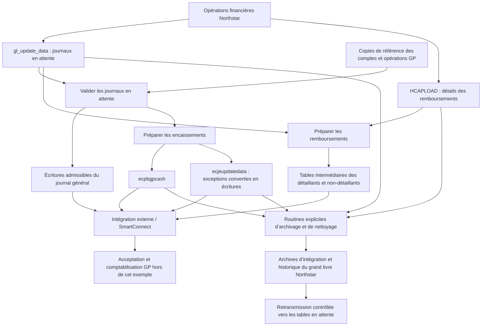

# Intégration Northstar–Microsoft Great Plains

## Documentation fonctionnelle

**Source :** [SampleInformixStoreProc.sql](SampleInformixStoreProc.sql)  
**Version anglaise :** [Documentation fonctionnelle originale](SampleInformixStoreProc.FunctionalDocumentation.md)  
**Date de préparation :** 29 octobre 2026  
**Méthode :** Analyse statique de l’exemple SQL fourni, sans exécution en base de données ni validation de la configuration de production.

## 1. Objectif et périmètre

Cet ensemble permet de transférer les opérations financières de Northstar/Pubs vers Microsoft Great Plains (GP). Ses principales fonctions consistent à valider les journaux en attente, préparer les encaissements et les remboursements à payer pour l’intégration, conserver l’historique des opérations, vider les données intermédiaires traitées et restaurer des opérations archivées en vue de leur retransmission. Il comprend également des utilitaires de migration du plan comptable et de conversion des soldes historiques.

Le fichier regroupe des tables, des vues, des données de configuration initiales et 15 procédures stockées. L’en-tête indique SQL Server 2008 et une date de génération du 12 mai 2022. Plusieurs routines conservent une syntaxe Informix SPL et des dates historiques de 2011–2012. Le présent document décrit donc la logique fonctionnelle visible et relève séparément les éléments incomplets ou incohérents de l’implémentation.

SmartConnect est mentionné dans les commentaires et dans une table de journalisation. Les définitions de correspondance SmartConnect, la configuration de connexion à GP, les traitements d’extraction, le processus de comptabilisation et les mécanismes de confirmation de réussite ne sont pas fournis. La préparation ou l’archivage d’une opération **ne prouve pas**, à lui seul, son acceptation ou sa comptabilisation dans GP.

## 2. Contexte métier et terminologie

| Terme | Signification dans cet ensemble |
|---|---|
| Northstar / Pubs | Application source de facturation, de gestion des clients et de gestion financière. Les deux noms apparaissent dans le code. |
| PB | Code d’application sélectionné pour la plupart des traitements courants d’intégration. |
| CR | Journal des encaissements. |
| RJ | Journal des remboursements; utilisé pour préparer les comptes fournisseurs et pour corriger ou retransmettre les écritures du grand livre. |
| AP / AR | Comptes fournisseurs / comptes clients. |
| Numéro pseudo | Référence interne Northstar à un compte du grand livre. |
| Compte de contrôle | Compte de trésorerie du grand livre configuré pour identifier l’écriture de trésorerie assurant la contrepartie. |
| Journal en attente | Détail dans `gl_update_data` en attente de traitement par l’intégration. |
| `description2` | Champ utilisé à la fois comme description et comme indicateur de statut ou d’orientation du traitement. |

Le catalogue initial comprend MP (participant au marché), IS (règlement de facture), DD (répartition des dépôts), RJ, OI (intérêts sur les montants en souffrance), LP (retard de paiement), EC (frais supplémentaires), CR, BJ (journal de facturation) et AJ (journal des ajustements). Les commentaires mentionnent également DB, DJ, BR, LO, AC, BT, WO et AM comme candidats à une correspondance SmartConnect. La présence d’un code au catalogue ne prouve pas que sa définition d’importation existe.

## 3. Flux d’intégration

Le diagramme représente les relations fonctionnelles entre les composants; il ne correspond pas à une séquence orchestrée implémentée. Lorsque l’intégration est activée, `ecJobScheduler` appelle uniquement la routine d’archivage global. Il n’appelle ni la validation, ni la préparation, ni l’importation GP.

Une séquence opérationnelle proposée consiste à actualiser les copies de référence GP, sauvegarder les données en attente, valider et analyser les exceptions, préparer les encaissements et remboursements, exécuter et rapprocher l’importation externe, puis archiver et supprimer les données dont le traitement est confirmé. Cette séquence doit être comparée aux traitements réels : l’exemple n’exige pas de confirmation de réussite de l’importation avant le nettoyage.

## 4. Entrées, sorties et données de référence

| Objet de données | Rôle fonctionnel |
|---|---|
| `gl_update_data`, `GL_UPDATE_CNTL` | Détail du grand livre en attente et enregistrements de contrôle des journaux. Le détail comprend société, application, code et numéro de journal, mois de comptabilisation, séquence, compte, numéro pseudo, montant signé, référence et descriptions. |
| `PB_UPDATE_DATA`, `PB_UPDATE_CNTL` | Structure de détail et de contrôle des mises à jour de facturation. Aucune routine fournie ne décrit leur extraction ni leur transfert vers les écritures en attente du grand livre. |
| `HCAPLOAD` | Source des remboursements : client/bénéficiaire, adresse postale, montant, journal, date du chèque, indicateur de compte final et renseignements bancaires/de dépôt direct. |
| `ecgl00105` | Référence des comptes GP utilisée pour comparer `GL_ACCOUNT` à `ACTNUMST`. |
| `ecgl10000`, `ecgl20000`, `ecgl30000` | Tables de référence de type GP pour les écritures non comptabilisées, comptabilisées de l’exercice courant et historiques. La table historique est définie mais n’est pas interrogée par le validateur de doublons fourni. |
| `ecpm10000`, `ecpm20000` | Références de type GP des comptes fournisseurs non comptabilisés et comptabilisés, utilisées pour détecter les doublons de remboursement. |
| `ecpbgpcash` | Ventilations des encaissements et lignes de contrôle préparées, y compris `controlamt`. |
| `ecjeupdatedata` | Exceptions d’encaissement réorientées vers le journal général. |
| `ecrjretailer`, `ecrjnonretailer` | Bénéficiaires, adresses, montants, comptes fournisseurs/achats, descriptions, types de remboursement et identifiants fournisseur préparés. |
| `ecglupdatedata` | Copie remplaçable du détail du grand livre en attente. |
| `ecgldetarc`, `ecrefundarc` | Archives du grand livre et des remboursements de l’intégration, avec date et utilisateur d’archivage. |
| `glsvdata`, `serialreg` | Historique du grand livre Northstar et registre de séquence associé; la définition du registre est absente. |
| `GLMASTER`, `GLCONTROL`, `ecpubsglmap` | Plan comptable et comptes de contrôle Northstar, et correspondance entre anciens comptes et comptes GP. |
| `pu_stat_det`, `ecStatsMapping` | Affectations des numéros pseudo aux catégories statistiques et instructions de conversion. |
| `pu_account`, `pu_acct_addr` | Références des clients/occupants et adresses secondaires. |
| `purtlrsh`, `tick_list` | Relations avec les détaillants et descriptions des rappels RJ (« ticklers »); définitions absentes. |
| `ecCustLog`, `ecpubsgperror`, `ecSmartConnectLog` | Messages de l’ordonnanceur, diagnostics de migration et structure de journal d’intégration. L’exemple n’écrit aucune entrée dans le journal SmartConnect. |

L’exemple ne précise pas comment les tables de référence GP sont actualisées. Les résultats de validation dépendent de leur exhaustivité et de leur actualité.

## 5. Validation des journaux

`ecVerifyPendingJournals` (ligne 4777 du source) sélectionne les couples code/numéro de journal dont `description2` est nul ou vide, puis applique les contrôles suivants dans l’ordre :

1. **Présence dans les écritures GP non comptabilisées :** recherche dans `ecgl10000.REFRENCE` et le numéro de lot. Les références CR commencent par `NS CR<numéro de journal>`; les autres par `NS <code de journal>`. Affecte `dupnotposted`.
2. **Déjà comptabilisé dans l’exercice courant :** recherche dans `ecgl20000.REFRENCE`, commençant par `NS <code de journal>`, avec `ORDOCNUM` égal au numéro de journal. Affecte `duppostedcurr`.
3. **Remboursement fournisseur déjà présent, non comptabilisé :** recherche dans `ecpm10000.BACHNUMB`, commençant par `REFUNDS_<code de journal>`. Affecte `rjdupnotpostedcurr`.
4. **Remboursement fournisseur déjà comptabilisé :** même préfixe dans `ecpm20000`. Affecte `rjduppostedcurr`.
5. **Exécution le 29 février :** affecte `leapyear` aux journaux encore admissibles. Le contrôle utilise la date système courante, et non la date de comptabilisation du journal.
6. **Compte du grand livre invalide :** exige une correspondance exacte dans `ecgl00105.ACTNUMST` pour les détails encore non signalés; sinon, affecte `invalidgl` au journal entier.

Après le premier contrôle de doublon, les contrôles suivants ne s’exécutent que si le journal n’a pas déjà été classé. Les mises à jour de statut utilisent uniquement le code et le numéro du journal, sans restriction de société ou d’application. Les contrôles des comptes fournisseurs n’imposent pas non plus de numéro de journal; leur portée est donc plus large que celle des contrôles du grand livre.

| Statut / indicateur | Signification |
|---|---|
| Nul / vide / espace | Indicateurs d’admissibilité, avec des conditions variables selon la routine. |
| `dupnotposted` | Journal correspondant trouvé dans les écritures GP non comptabilisées. |
| `duppostedcurr` | Journal correspondant trouvé dans les écritures GP comptabilisées de l’exercice courant. |
| `rjdupnotpostedcurr` | Préfixe de lot fournisseur correspondant trouvé parmi les écritures non comptabilisées. |
| `rjduppostedcurr` | Préfixe de lot fournisseur correspondant trouvé parmi les écritures comptabilisées. |
| `invalidgl` | Au moins un compte du journal manque dans la référence des comptes GP. |
| `leapyear` | Traitement tenté le 29 février. |
| `EXCEPTION` | Journal d’encaissement incompatible avec le traitement ordinaire. |
| `MOVETOGJ` | Indicateur intermédiaire de conversion d’un encaissement en écritures du journal général. |
| `BANKREC`, `EXCEPTIONS` | Indicateurs attribués respectivement aux lignes de contrôle et aux autres lignes converties. |
| `CONTROL AMOUNT` | Indicateur de ligne de contrôle d’encaissement préparée; effacé lors de la restauration pour retransmission. |
| `duppostedprior` | Présent dans la vue des exceptions, mais jamais affecté par le validateur fourni. |

`ecExceptionsCheck` (ligne 2733) affiche `EXCEPTION`, `duppostedcurr`, `dupnotposted`, `duppostedprior` et `invalidgl`. La vue omet les statuts de doublon fournisseur et `leapyear`; elle ne constitue donc pas une liste exhaustive des exceptions opérationnelles.

## 6. Préparation des encaissements

`ecPrepareCashForGP` (ligne 3912) reconstruit `ecpbgpcash` et `ecjeupdatedata`, en vidant leur contenu par troncature avant de vérifier la configuration.

La procédure lit le compte de contrôle de trésorerie dans la ligne 1 de `ecgpcontrol` et s’arrête si ce compte est nul. Elle regroupe les lignes PB/CR admissibles hors compte de contrôle par journal, mois, compte, pseudo, référence et descriptions, puis additionne les montants signés. Les totaux nuls sont ignorés. Malgré un commentaire indiquant une sélection des crédits, la requête sélectionne tous les montants, puis distingue les traitements selon le signe.

- Une ventilation négative peut devenir une ligne d’encaissement ordinaire si un montant positif existe au compte de contrôle pour le journal. Ce montant est reporté dans `controlamt`.
- Une ventilation positive hors compte de contrôle, ou l’absence de contrepartie positive au contrôle, place le journal entier en exception.
- Avec `makeexceptje=N`, l’indicateur est `EXCEPTION`.
- Avec `makeexceptje=Y`, l’indicateur est `MOVETOGJ`. Les détails sont copiés dans `ecjeupdatedata`, avec `BANKREC` pour le compte de contrôle et `EXCEPTIONS` pour les autres lignes, puis supprimés de `gl_update_data`.
- Les lignes de contrôle admissibles non nulles sont ajoutées à `ecpbgpcash` avec la description `CASH RECEIPTS`, l’indicateur `CONTROL AMOUNT` et `controlamt=0`.

**Exemple :** un débit de contrôle de trésorerie de +100 et un crédit admissible hors contrôle de −100 suivent le traitement ordinaire. Une ligne positive hors contrôle déclenche le traitement d’exception ou du journal général. Cet exemple illustre les règles de signe prévues; le code contient des erreurs de syntaxe de contrôle et n’a pas été exécuté.

Il n’existe aucun contrôle explicite de l’équilibre du journal, aucune exigence d’une seule ligne de contrôle et aucune suppression finale des lignes d’encaissement déjà insérées si une ventilation ultérieure place le journal en exception. Ces éléments doivent être couverts par le rapprochement opérationnel.

## 7. Préparation des remboursements à payer

`ecPrepRefunds` (ligne 3488) prépare les remboursements par bénéficiaire à partir de `HCAPLOAD` et reconstruit les tables de sortie des détaillants et non-détaillants. La procédure exige d’abord les quatre comptes fournisseurs et achats configurés, généraux et propres aux détaillants. Si l’un est nul, elle affiche un message et s’arrête avant la reconstruction des sorties.

### 7.1 Classement et regroupement

Les remboursements des détaillants sélectionnent les comptes ayant une relation `purtlrsh` dont `rtlrid` commence par `ER`. Les remboursements des non-détaillants sélectionnent les comptes **n’ayant pas** de relation dont `rtlrid` **ne commence pas** par `ER`. Ces conditions ne sont pas complémentaires : un compte ayant uniquement une relation ER peut apparaître dans les deux sorties. Le classement métier doit être confirmé avant de considérer les listes comme mutuellement exclusives.

Les montants sont additionnés par compte, nom, adresse, journal et date du chèque; le regroupement des non-détaillants comprend aussi l’indicateur de compte final. La séquence source maximale est conservée. La préparation ne sélectionne pas exclusivement les montants positifs et ne limite pas explicitement HCAPLOAD aux enregistrements RJ.

### 7.2 Sélection des comptes du grand livre

Pour le journal PB/RJ correspondant, les lignes négatives fournissent le compte fournisseur et les lignes positives le compte d’achats. Si plusieurs lignes existent pour un signe, le compte par défaut applicable est utilisé. Avec une seule ligne, son compte est retenu, avec recours au compte par défaut si la valeur est nulle. Les détaillants utilisent leurs paramètres propres; les non-détaillants utilisent les paramètres généraux. La décision compte les lignes, et non les numéros de compte distincts.

### 7.3 Bénéficiaire, adresse et description

La sortie des détaillants utilise l’adresse postale HCAPLOAD, la description `NS AP-RETAILER REFUND RJ<numéro de journal>`, le type `DFLT` et le dernier code d’occupant Northstar. L’identifiant fournisseur prévu concatène le numéro de compte et le code d’occupant, avec un zéro initial lorsque ce code comporte un seul chiffre.

Pour les non-détaillants, `uselongaddress=Y` active la recherche d’une adresse secondaire du type configuré. Un indicateur final égal à `1` sélectionne le dernier code d’occupant moins un; les autres enregistrements utilisent le dernier occupant. Si une adresse secondaire existe, ses noms et coordonnées remplacent l’adresse postale et l’indicateur de provenance devient `longaddress`; sinon, la branche de recherche affecte `mailingaddress`.

Avec `useticker=Y` et `nonretailer=cambridge`, une valeur `remote` égale à `F` ou `M` sur le dernier enregistrement du compte produit le type `GEN` et une description commençant par `-Generation-`, suivie des renseignements de rue de l’adresse de service. Les autres comptes reçoivent le type `CIS`; le premier rappel RJ couvrant la date du chèque fournit la description, avec `dfltnonretdesc` comme valeur de repli. Aucun tri ne détermine quel rappel est le premier. Les autres méthodes avec rappels activés utilisent `DFLT` / `Non Retailer refund` et l’occupant zéro. Lorsque les rappels sont désactivés, le repli explicite existe uniquement pour la méthode `DEFAULT`.

La construction de l’identifiant fournisseur des non-détaillants contient une variable d’occupant non définie ou mal orthographiée. Certaines variables de travail ne sont pas réinitialisées de façon cohérente entre les bénéficiaires. Ces sorties nécessitent une correction et une validation de l’implémentation avant utilisation en production.

Les renseignements bancaires et de dépôt direct sont conservés dans les sources et les archives, mais ne figurent pas dans les définitions des tables préparées pour détaillants et non-détaillants. L’exemple ne précise pas comment les instructions de paiement sont transmises à GP.

## 8. Archivage et nettoyage

### 8.1 Traitement global

`ecmovegldetail(@p_user char(10))` (ligne 2972) :

1. Lit la prochaine séquence de l’historique du grand livre Northstar dans `serialreg`.
2. Supprime les entrées existantes de `ecgldetarc` et `glsvdata` pour les clés des journaux PB non-CR en attente, y compris celles dont les détails peuvent être signalés en exception.
3. Copie les détails PB non-CR admissibles dans les deux archives, avec `description2='ecaliber'` et `proc_yn='Y'` dans l’historique Northstar.
4. Supprime les enregistrements de contrôle et les détails en attente sélectionnés par ses conditions de statut vide/nul. Ce nettoyage a une portée plus large que la sélection d’archivage PB/non-CR.
5. Copie tous les enregistrements HCAPLOAD dans `ecrefundarc`, en remplaçant ceux ayant la même séquence source, puis supprime toutes les lignes HCAPLOAD et les remboursements préparés.
6. Remplace les archives et historiques existants pour les clés des journaux d’encaissement préparés, archive toutes les lignes `ecpbgpcash`, montants de contrôle compris, puis vide cette table.
7. Remplace les archives et historiques existants pour les clés de `ecjeupdatedata`, archive ces lignes en effaçant la description secondaire dans l’archive d’intégration et avec un montant de contrôle nul, puis vide la table intermédiaire.

Les archives enregistrent l’utilisateur fourni et la date courante. L’historique Northstar utilise l’heure d’exécution courante et des séquences générées. Les mises à jour du registre de séquence sont conditionnelles et doivent être revues, notamment lorsque des encaissements existent sans ligne ultérieure de journal général.

La procédure ne vérifie pas la réussite dans GP avant de supprimer les données actives et n’englobe pas tout le traitement dans une transaction explicite. La valeur `proc_yn='Y'` est un indicateur d’historique affecté par le code; elle ne prouve pas la comptabilisation dans GP.

### 8.2 Traitement d’un journal sélectionné

`ecreqmovegldetail(@p_user char(10), @p_jrnltype char(4), @p_jrnlno integer)` (ligne 5070) assure un archivage et un nettoyage ciblés :

| Type demandé | Comportement |
|---|---|
| Autre que `RJAP` ou `CR` | Copie les détails PB non-CR correspondants dans `ecgldetarc`; `RJAR` est converti en code RJ. La sélection d’archivage comprend les lignes signalées, mais la suppression des données en attente utilise un statut vide/nul. |
| `RJAP` | Archive les remboursements RJ HCAPLOAD sélectionnés, supprime leurs lignes source et préparées et supprime les détails RJ admissibles du grand livre en attente. |
| `CR` | Choisit `ecpbgpcash` dès qu’une ligne quelconque existe dans cette table; sinon, choisit `ecjeupdatedata`. Archive et supprime les lignes du journal sélectionné. Ce choix global peut privilégier la table des encaissements même si le journal demandé existe uniquement dans la table du journal général. |

Cette routine ne met à jour ni `glsvdata` ni son registre et ne supprime pas les enregistrements de contrôle du grand livre. Son code comporte une syntaxe invalide mélangeant les dialectes.

### 8.3 Reconstitution de l’historique

`ecrefreshnsarchive(@p_user char(10))` (ligne 4930) ajoute toutes les lignes `ecgldetarc` à `glsvdata`, avec de nouvelles séquences, les dates d’archivage originales, l’heure d’exécution courante et les indicateurs `ecaliber`/`Y`. La procédure ne vide pas l’historique et ne vérifie pas la présence de copies existantes. Des exécutions répétées peuvent créer des doublons. Le paramètre utilisateur fourni n’est pas utilisé pour attribuer les sorties.

## 9. Sauvegarde et retransmission

| Procédure | Entrées | Comportement fonctionnel |
|---|---|---|
| `ecBackupPendingJrnl` (2764) | Aucune | Vide `ecglupdatedata` par troncature, puis copie tous les détails du grand livre en attente. Il s’agit d’une seule copie remplaçable, sans historique de versions. |
| `ecReSendGLTransactions` (4094) | Code de journal `char(2)`, numéro de journal `integer` | Restaure les lignes d’archive société 1 / PB dans `gl_update_data`, en excluant l’indicateur exact `EXCEPTION`. Efface `CONTROL AMOUNT` à la restauration. Conserve les autres statuts. |
| `ecReSendRefunds` (4138) | Numéro de journal `integer`, type `char(2)` | Le type `AP` restaure les remboursements archivés positifs dans HCAPLOAD. Tout autre type restaure les détails archivés société 1 / PB / RJ dans le grand livre en attente. |

Les routines insèrent sans vérifier la présence d’une copie en attente, sans supprimer l’archive et sans confirmer l’absence de l’opération dans GP. Toute retransmission doit être accompagnée d’une validation des doublons et d’un rapprochement. Les numéros de séquence de l’archive du grand livre sont générés par une colonne d’identité et réutilisés à la restauration; ils ne correspondent pas nécessairement aux séquences source originales.

## 10. Migration des comptes et utilitaires complémentaires

| Procédure | Comportement fonctionnel |
|---|---|
| `ecFixMapping` (2805) | Complète les comptes source de 5, 6 ou 7 caractères par des zéros à gauche pour obtenir une longueur de 8. Ne modifie pas les comptes GP ni les autres longueurs. |
| `ecGLMigration` (2845) | Vide les diagnostics de migration et traite les lignes GLMASTER dont les deux champs de compte sont renseignés. Supprime les comptes de contrôle ayant des sous-comptes et les comptes sans correspondance, en journalisant le résultat. Si le compte GP existe déjà, supprime l’ancienne ligne maître et réaffecte les références pseudo statistiques. Sinon, remplace les deux champs de compte par le numéro GP correspondant. Convertit les comptes de surplus, d’attente et interfonds de la société 1, puis définit le format de compte configuré. |
| `ecMapStatCodes` (3452) | Met à jour `pu_stat_det.cat_pseudo` selon les correspondances exactes de code statistique, type de service, catégorie et ancien pseudo dans `ecStatsMapping`. |
| `ecLoadHfinsGLBal` (3384) | Utilitaire historique pour JUL/2011, AUG/2011 et SEP/2011, créant les journaux GL/GJ 1 à 3 dans `ecgpjepending`. Utilise le débit, sauf si son arrondi est zéro, auquel cas il utilise le crédit négatif. Supprime d’abord `GPjepending`, dont le nom diffère de la cible d’insertion. Contient du code Informix SPL. |
| `ecTableInstaller` (4246) | Crée un sous-ensemble des tables de support et d’intégration et des données initiales historiques. Contient des définitions répétées par rapport au script principal, des différences de noms et des objets liés à OCEB. Il s’agit d’un utilitaire d’installation. |

La migration modifie les données maîtres Northstar et supprime des lignes. Elle est distincte de la préparation quotidienne des journaux. L’exemple ne fournit ni migration complète des dépendances en aval ni procédure complète de retour arrière.

## 11. Configuration et ordonnancement

La ligne 1 de `ecgpcontrol` fournit le compte et le pseudo de contrôle de trésorerie, le format de compte, les comptes fournisseurs/achats généraux et ceux des détaillants. `nsfacct` est défini, mais n’est pas utilisé par la logique analysée. Les comptes initialisés sont des exemples de configuration, et non des paramètres de production validés.

| Paramètre `eckeyval` | Valeur initiale | Effet fonctionnel |
|---|---|---|
| `uselongaddress` | `Y` | Active l’adresse secondaire des non-détaillants; valeur absente remplacée par N. |
| `useticker` | `Y` | Active les descriptions à partir des rappels; orthographe conservée telle qu’implémentée. Valeur absente remplacée par N. |
| `nonretailer` | `cambridge` | Sélectionne la logique propre au client pour les non-détaillants; valeur absente remplacée par DEFAULT. |
| `addresstype` | `LONG MAIL` | Type d’adresse secondaire à rechercher. Le mécanisme de repli vérifie la mauvaise variable dans l’exemple. |
| `dfltnonretdesc` | `Credit Account` | Description CIS de repli lorsqu’aucun rappel n’est disponible. |
| `makeexceptje` | `Y` | Convertit les exceptions d’encaissement en écritures de journal; valeur absente remplacée par N. |

`ecJobScheduler(@p_custid integer)` (ligne 3316) supprime les anciens messages `ecCustLog` du client, lit `ecControlr.asofdate` ou la date système et vérifie l’attribut client 5 (`Pubs - GP Integration`). Si sa valeur est `Y`, il journalise l’exécution de l’archivage/nettoyage et appelle `ecmovegldetail 'root'`; sinon, il journalise la non-exécution.

La date de référence sélectionnée n’est pas transmise à l’archivage, qui utilise sa propre date système courante. Cet ordonnanceur ne définit ni fréquence, ni contrôle des jours fériés, ni validation, ni importation externe, ni vérification de réussite, ni interception des erreurs. Le message est écrit avant l’appel d’archivage et ne confirme donc pas sa bonne fin. Les autres attributs et objets de jours fériés/OCEB semblent appartenir à une infrastructure partagée; leur présence ne démontre pas leur utilisation dans ce traitement.

## 12. Exceptions, contrôles et limites de l’exemple

Le code repose principalement sur des indicateurs de statut, des messages affichés et les erreurs de la base de données. Il ne possède ni gestion structurée complète des erreurs ni transaction explicite de bout en bout avec retour arrière. Les principaux constats sont les suivants :

- **Compatibilité d’exécution :** mélange de T-SQL et d’Informix (`define`, `let`, `foreach`, `continue foreach`), instructions initiales de journaux mal formées, vue `ecActiveJrnlUsed` incomplète (`select` sans corps), variables non définies ou mal orthographiées et nombres de colonnes incohérents dans les insertions, notamment pour `gl_update_data` avec ses colonnes de relation supplémentaires. La compilation de l’ensemble fourni n’est pas démontrée.
- **Dépendances externes :** `serialreg`, `purtlrsh` et `tick_list` sont référencées sans définition; l’actualisation des références GP et les définitions SmartConnect sont absentes.
- **Détection des doublons :** aucune recherche dans les exercices historiques malgré la table correspondante et l’indicateur `duppostedprior`. La recherche des lots de remboursement est large et plusieurs mises à jour/suppressions omettent la société et l’application.
- **Remplacement des sorties :** les préparations vident les tables intermédiaires et le nettoyage global supprime largement les entrées de remboursement. Sans contrôle externe, des échecs ou exécutions concurrentes peuvent entraîner une perte ou un mélange de données.
- **Archivage :** certains historiques sont supprimés avant l’application des filtres d’admissibilité. La reconstitution ajoute sans dédoublonnage. L’archivage ciblé ne réalise pas les mêmes mises à jour d’historique que l’archivage global.
- **Classement et enrichissement des remboursements :** les conditions détaillant/non-détaillant peuvent se chevaucher; la construction des fournisseurs et la réinitialisation des variables sont incohérentes; le repli du type d’adresse vérifie la mauvaise variable.
- **Vérification financière :** aucun équilibrage global explicite des débits/crédits, rapprochement des totaux par bénéficiaire ou contrôle d’acceptation GP n’est implémenté.

Ces constats concernent l’exemple fourni. Ils ne constituent pas des défauts confirmés d’une version déployée séparément.

## 13. Liste de vérification pour la réception opérationnelle

Les vérifications suivantes sont recommandées; elles ne sont pas automatisées par le script :

1. Confirmer le dialecte de base de données, les versions déployées, les dépendances, la société GP et les définitions d’intégration.
2. Vérifier l’actualisation des références GP et l’exhaustivité de la correspondance entre anciens et nouveaux comptes avant migration ou validation.
3. Tester les journaux valides, les doublons non comptabilisés/courants/historiques, les lots de remboursement, les comptes invalides et le 29 février.
4. Rapprocher les encaissements ordinaires et les montants de contrôle; tester les ventilations positives, les contrôles absents ou multiples, les totaux nuls et les deux paramètres d’exception.
5. Confirmer l’exclusivité du classement des remboursements, le choix des comptes fournisseurs/achats, l’adresse de l’occupant final, les descriptions de repli, les identifiants fournisseur et le dépôt direct.
6. Rapprocher les nombres de lignes et les totaux signés entre source, tables intermédiaires, acceptation GP et archives avant le nettoyage.
7. Tester les échecs partiels, les répétitions, le nettoyage ciblé et les retransmissions contrôlées sans créer de doublons.

## 14. Points à confirmer avec les responsables métier ou du déploiement

- Quelle plateforme et quelles versions de procédures correspondent à l’intégration réelle?
- Quelles sont les définitions SmartConnect, les conditions de déclenchement, les fréquences et les confirmations de fin?
- Les importations sont-elles comptabilisées automatiquement dans GP ou soumises à l’équipe financière?
- Quelle règle distingue un détaillant d’un non-détaillant, et les deux sorties peuvent-elles se chevaucher?
- Pourquoi le 29 février est-il bloqué, et cette règle historique s’applique-t-elle encore?
- Quelles règles font autorité pour les fournisseurs, les occupants, les paiements bancaires et les dates de chèque?
- Qui autorise le nettoyage des archives et les retransmissions, et comment les totaux GP sont-ils rapprochés?
- Les clés de journal sont-elles suffisamment uniques entre sociétés pour les conditions larges de cet exemple?

## 15. Repères dans le code source

Les numéros de ligne correspondent au fichier analysé et peuvent changer après modification.

| Zone du source | Première ligne |
|---|---:|
| Schéma et configuration initiale | 871 |
| Vues et relations | 2726 |
| Copie des écritures en attente | 2764 |
| Normalisation des correspondances / migration du grand livre | 2805 / 2845 |
| Archivage global | 2972 |
| Ordonnanceur | 3316 |
| Soldes historiques / correspondances statistiques | 3384 / 3452 |
| Préparation des remboursements | 3488 |
| Préparation des encaissements | 3912 |
| Retransmission du grand livre / des remboursements | 4094 / 4138 |
| Installation | 4246 |
| Validation des écritures en attente | 4777 |
| Reconstitution de l’historique Northstar | 4930 |
| Archivage d’un journal sélectionné | 5070 |
