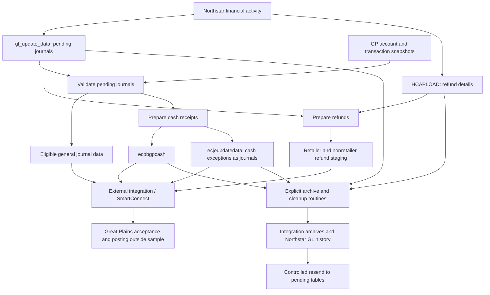

# Northstar–Microsoft Great Plains Integration

## Functional documentation

**Source:** [SampleInformixStoreProc.sql](SampleInformixStoreProc.sql)  
**Prepared:** October 29, 2026  
**Basis:** Static review of the supplied SQL sample; no database execution or production configuration validation.

## 1. Purpose and scope

The package supports transferring Northstar/Pubs financial activity to Microsoft Great Plains (GP). Its main responsibilities are to validate pending journals, prepare cash receipts and refund payables for integration, retain transaction history, clear processed staging data, and restore archived transactions for resending. It also includes chart-of-accounts migration and historical balance conversion utilities.

This is a collection of tables, views, seed configuration, and 15 stored procedures, rather than a single procedure. The header identifies SQL Server 2008 and a generation date of May 12, 2022. Several routines retain Informix SPL syntax and historical dates from 2011–2012. Consequently, this document describes visible functional logic and identifies incomplete or inconsistent implementation separately.

SmartConnect is referenced in comments and a log table. The actual SmartConnect maps, GP connection configuration, source extraction jobs, posting process, and success callbacks are not supplied. Preparing or archiving a transaction in this package does **not** by itself establish that GP accepted or posted it.

## 2. Business context and terminology

| Term | Meaning in this package |
|---|---|
| Northstar / Pubs | Source billing/customer and financial application; both names occur in the code. |
| PB | Application code selected for most routine integration processing. |
| CR | Cash receipt journal. |
| RJ | Refund journal; supports payable preparation and GL correction/resend paths. |
| AP / AR | Accounts payable / accounts receivable. |
| Pseudo number | Northstar internal reference to a GL account. |
| Control account | Configured cash GL account used to identify the balancing cash entry. |
| Pending journal | Detail in `gl_update_data` awaiting integration handling. |
| `description2` | Both descriptive data and an integration status/routing field. |

The seed journal catalogue includes MP (Market Participant), IS (Invoice Settlement), DD (Deposit Distribution), RJ, OI (Overdue Interest), LP (Late Payment), EC (Extra Charge), CR, BJ (Billing Journal), and AJ (Adjustment Journal). Additional commented SmartConnect mapping candidates are DB, DJ, BR, LO, AC, BT, WO, and AM. Catalogue entries do not prove that corresponding import maps are implemented.

## 3. Integration flow

The diagram expresses the functional relationship between components, not an implemented orchestrated sequence. `ecJobScheduler` calls only the bulk archive routine when integration is enabled. It does not call validation, preparation, or a GP import.

A proposed operational sequence is: refresh GP snapshots; preserve pending data; validate and investigate exceptions; prepare cash/refund outputs; execute and reconcile the external import; then archive and clear confirmed work. This sequence requires confirmation against the actual integration jobs because the sample does not enforce a successful-import gate before cleanup.

## 4. Inputs, outputs, and reference data

| Data object | Functional role |
|---|---|
| `gl_update_data`, `GL_UPDATE_CNTL` | Pending GL detail and journal control records. Detail includes company, application, journal code/number, posting month, sequence, account, pseudo number, signed amount, reference, and descriptions. |
| `PB_UPDATE_DATA`, `PB_UPDATE_CNTL` | Billing update detail/control schema; no routine in this sample establishes their extraction or movement into GL pending data. |
| `HCAPLOAD` | Refund source: customer/payee, mailing address, amount, journal, cheque date, final-account indicator, and banking/direct-deposit fields. |
| `ecgl00105` | GP account reference used to validate `GL_ACCOUNT` against `ACTNUMST`. |
| `ecgl10000`, `ecgl20000`, `ecgl30000` | GP-style unposted, current-year posted, and historical GL reference tables. Historical table is defined but not queried by the supplied duplicate validator. |
| `ecpm10000`, `ecpm20000` | GP-style unposted and posted payable references used for refund duplicate checks. |
| `ecpbgpcash` | Prepared cash distributions and control lines, including `controlamt`. |
| `ecjeupdatedata` | Cash exceptions rerouted as general journal detail. |
| `ecrjretailer`, `ecrjnonretailer` | Prepared refund payees, addresses, amounts, AP/purchase accounts, descriptions, refund types, and vendor identifiers. |
| `ecglupdatedata` | Replaceable snapshot of pending GL detail. |
| `ecgldetarc`, `ecrefundarc` | Integration GL/refund archives with archive date and user. |
| `glsvdata`, `serialreg` | Northstar GL history and its sequence registry; registry schema is absent. |
| `GLMASTER`, `GLCONTROL`, `ecpubsglmap` | Northstar chart/control accounts and old-to-GP account translation. |
| `pu_stat_det`, `ecStatsMapping` | Statistical/category GL pseudo assignments and remapping instructions. |
| `pu_account`, `pu_acct_addr` | Customer/occupant and alternate address reference data. |
| `purtlrsh`, `tick_list` | Retailer relationship and RJ tickler descriptions; schemas are absent. |
| `ecCustLog`, `ecpubsgperror`, `ecSmartConnectLog` | Scheduler messages, migration diagnostics, and a defined integration log structure. The sample does not write SmartConnect log entries. |

The sample does not show how GP reference tables are refreshed. Validation results depend on their completeness and currency.

## 5. Journal validation

`ecVerifyPendingJournals` (source line 4777) selects journal code/number pairs whose `description2` is null or empty and checks them in this order:

1. **Already unposted in GP:** match `ecgl10000.REFRENCE` and batch number. CR references begin `NS CR<journal number>`; other references begin `NS <journal code>`. Set `dupnotposted`.
2. **Already posted in the current year:** match `ecgl20000.REFRENCE` beginning `NS <journal code>` and `ORDOCNUM` equal to the journal number. Set `duppostedcurr`.
3. **Refund payable already unposted:** match `ecpm10000.BACHNUMB` beginning `REFUNDS_<journal code>`. Set `rjdupnotpostedcurr`.
4. **Refund payable already posted:** use the same prefix against `ecpm20000`. Set `rjduppostedcurr`.
5. **Run date is February 29:** flag remaining eligible journals `leapyear`. The check uses the current system date, not the journal posting date.
6. **Invalid GL account:** for remaining unflagged details, require an exact account match in `ecgl00105.ACTNUMST`; otherwise flag the entire journal `invalidgl`.

Each duplicate check after the first runs only if the journal has not already been classified. Journal status updates are keyed by journal code and number, without company or application restrictions. The payable duplicate checks also lack a journal-number condition, making them broader than the GL checks.

| Status / marker | Meaning |
|---|---|
| Null / empty / space | Used as eligibility indicators, with inconsistent predicates across routines. |
| `dupnotposted` | Matching unposted GP GL journal found. |
| `duppostedcurr` | Matching current-year posted GP GL journal found. |
| `rjdupnotpostedcurr` | Matching unposted payable batch prefix found. |
| `rjduppostedcurr` | Matching posted payable batch prefix found. |
| `invalidgl` | At least one journal account missing from GP account reference. |
| `leapyear` | Processing attempted on February 29. |
| `EXCEPTION` | Cash journal cannot use the ordinary receipt route. |
| `MOVETOGJ` | Intermediate routing marker for cash-to-general-journal conversion. |
| `BANKREC`, `EXCEPTIONS` | Markers assigned to converted control and other journal lines respectively. |
| `CONTROL AMOUNT` | Prepared cash control-line marker; cleared when restored for resend. |
| `duppostedprior` | Included in the exception view, but never assigned by the supplied validator. |

`ecExceptionsCheck` (line 2733) shows `EXCEPTION`, `duppostedcurr`, `dupnotposted`, `duppostedprior`, and `invalidgl`. It omits the refund duplicate statuses and `leapyear`, so it is not a complete operational exception list.

## 6. Cash receipt preparation

`ecPrepareCashForGP` (line 3912) rebuilds both `ecpbgpcash` and `ecjeupdatedata`, truncating their prior contents before checking configuration.

It reads the cash control account from `ecgpcontrol` row 1 and exits if that account is null. It groups eligible PB/CR non-control lines by journal, month, account, pseudo, reference, and descriptions, summing signed amounts. Zero totals are skipped. Although a comment says it selects credits, the query selects all amounts and then branches on sign.

- A negative distribution amount can become an ordinary cash receipt line if a positive cash control amount exists for the journal. That amount is carried in `controlamt`.
- A positive non-control distribution, or a missing positive control entry, marks the whole journal as an exception.
- With `makeexceptje=N`, the marker is `EXCEPTION`.
- With `makeexceptje=Y`, the marker is `MOVETOGJ`. Those details are copied into `ecjeupdatedata`, labelled `BANKREC` for the control account and `EXCEPTIONS` otherwise, then removed from `gl_update_data`.
- Eligible nonzero control lines are added to `ecpbgpcash` with description `CASH RECEIPTS`, marker `CONTROL AMOUNT`, and `controlamt=0`.

**Illustration:** a cash control debit of +100 and eligible non-control credit of −100 follow the ordinary cash route. A positive non-control line triggers the exception/general-journal route. This illustrates the intended sign rules; the sample contains control-flow syntax errors and has not been executed.

There is no explicit journal-balance test, no enforced single-control-line test, and no final removal of already-inserted cash staging rows if a later distribution flags the journal. These are reconciliation points for an implemented workflow.

## 7. Refund payable preparation

`ecPrepRefunds` (line 3488) prepares payee-level refund data from `HCAPLOAD`, rebuilding retailer and nonretailer output tables. It first requires all four configured default/retailer AP and purchase accounts; if any is null it prints a message and returns before rebuilding outputs.

### 7.1 Classification and aggregation

Retailer refunds select accounts having a `purtlrsh` relationship whose `rtlrid` starts with `ER`. Nonretailer refunds select accounts **not** having a relationship whose `rtlrid` does **not** start with `ER`. These predicates are not complementary: an account with only an ER relationship may appear in both outputs. Confirm the intended business classification before relying on mutually exclusive payee lists.

Refund amounts are summed by account, name, address, journal, and cheque date; the nonretailer grouping also includes the final-account flag. The maximum source sequence is retained. Preparation does not filter to positive amounts or explicitly restrict HCAPLOAD to RJ records.

### 7.2 GL account selection

For the corresponding PB/RJ journal, negative lines supply the AP account and positive lines supply the purchase account. If more than one line exists for a sign, the relevant configured default is used. With a single line its GL account is selected, with a default fallback if null. Retailers use retailer defaults; nonretailers use general defaults. The decision counts rows, not distinct account numbers.

### 7.3 Payee, address, and description rules

Retailer output uses HCAPLOAD mailing details, description `NS AP-RETAILER REFUND RJ<journal number>`, refund type `DFLT`, and the latest Northstar occupant code. The intended vendor ID concatenates account number with occupant code, adding a leading zero for a one-digit occupant.

For nonretailers, `uselongaddress=Y` enables an alternate address lookup using the configured address type. A final flag of `1` selects latest occupant minus one; other records select the latest occupant. When an alternate address exists, its names/address replace mailing details and the provenance marker becomes `longaddress`; otherwise the lookup branch marks `mailingaddress`.

With `useticker=Y` and `nonretailer=cambridge`, the latest account's remote value `F` or `M` produces refund type `GEN` and description beginning `-Generation-` followed by service street information. Other accounts become type `CIS`; the first available RJ tickler covering the cheque date supplies the description, with `dfltnonretdesc` as fallback. No ordering determines which tickler is first. Other tickler-enabled methods use `DFLT` / `Non Retailer refund` and occupant zero. With ticklers disabled, the explicit fallback is implemented only for method `DEFAULT`.

Nonretailer vendor-ID construction contains an undefined/misspelled occupant variable. Some working variables are not reset consistently between payees. These outputs require implementation correction and validation before production use.

Bank and direct-deposit fields are retained in source/archive records but are not included in the prepared retailer/nonretailer table definitions. The sample does not establish how GP payment-method instructions are delivered.

## 8. Archiving and cleanup

### 8.1 Bulk processing

`ecmovegldetail(@p_user char(10))` (line 2972):

1. Reads the next Northstar GL history sequence from `serialreg`.
2. Deletes existing `ecgldetarc` and `glsvdata` entries for pending PB non-CR journal keys, including keys whose pending details may be flagged.
3. Copies eligible PB non-CR details to both archives, setting Northstar history `description2='ecaliber'` and `proc_yn='Y'`.
4. Deletes pending control records and GL details selected by its blank/null status predicates. This cleanup has broader scope than the PB/non-CR archive selection.
5. Copies all HCAPLOAD records to `ecrefundarc`, replacing existing rows with the same source sequence, and clears all HCAPLOAD and prepared refund rows.
6. Replaces existing archive/history entries for cash staging journal keys, archives all `ecpbgpcash` lines including control amounts, and clears cash staging.
7. Replaces existing archive/history entries for `ecjeupdatedata` journal keys, archives these lines with the integration archive secondary description cleared and control amount zero, and clears journal staging.

Archives record the supplied user and current date. Northstar history uses current run time and generated sequences. Sequence-registry updates are conditional and need review, particularly when cash data exists without a subsequent general-journal row.

The procedure does not query GP for success before deleting active data and does not wrap the full process in an explicit transaction. Its `proc_yn='Y'` is an assigned history marker, not evidence of GP posting.

### 8.2 Selected-journal processing

`ecreqmovegldetail(@p_user char(10), @p_jrnltype char(4), @p_jrnlno integer)` (line 5070) provides selective archive/cleanup:

| Requested type | Behavior |
|---|---|
| Other than `RJAP` or `CR` | Copies matching PB non-CR GL details to `ecgldetarc`; `RJAR` maps to journal code RJ. Archive selection includes flagged rows, while pending deletion uses blank/null status. |
| `RJAP` | Archives selected RJ HCAPLOAD refunds, clears selected refund source/output rows, and deletes eligible RJ pending GL detail. |
| `CR` | Chooses cash staging when **any** row exists in `ecpbgpcash`; otherwise chooses `ecjeupdatedata`. Archives selected journal lines and clears the selected staging rows. This global branch can choose cash even if the requested journal exists only in journal staging. |

Unlike bulk processing, this routine does not update `glsvdata` or its registry and does not delete GL control records. Its source includes invalid mixed-dialect syntax.

### 8.3 History refresh

`ecrefreshnsarchive(@p_user char(10))` (line 4930) appends all `ecgldetarc` lines into Northstar `glsvdata`, using new history sequences, original archive dates, current run time, and `ecaliber`/`Y` markers. It neither clears history nor checks for existing copies. Repeating it may duplicate history. The supplied user parameter is not used for output attribution.

## 9. Backup and resend

| Procedure | Inputs | Functional behavior |
|---|---|---|
| `ecBackupPendingJrnl` (2764) | None | Truncates `ecglupdatedata`, then copies all pending GL details. This is one replaceable snapshot, not versioned backup history. |
| `ecReSendGLTransactions` (4094) | Journal code `char(2)`, journal number `integer` | Restores company 1 / PB archive lines to `gl_update_data`, excluding exact `EXCEPTION` markers. Clears `CONTROL AMOUNT` on restoration. Other status values are retained. |
| `ecReSendRefunds` (4138) | Journal number `integer`, type `char(2)` | Type `AP` restores positive archived refund amounts to HCAPLOAD. Every other type restores company 1 / PB / RJ archived GL detail to pending GL. |

Resend routines insert data without checking for an existing pending copy, removing the archive, or confirming the target transaction is absent from GP. Duplicate validation and reconciliation must accompany a resend. Archive GL sequence numbers are identities and are reused as pending sequence values on restoration; they are not necessarily the original source sequence numbers.

## 10. Account migration and supporting utilities

| Procedure | Functional behavior |
|---|---|
| `ecFixMapping` (2805) | Pads source mapping accounts of length 5, 6, or 7 with leading zeros to length 8. Does not change GP mapping values or other lengths. |
| `ecGLMigration` (2845) | Clears migration diagnostics; processes GLMASTER rows with both account fields populated. Deletes controlled accounts with subaccounts and accounts missing a translation, logging the outcome. If the GP account already exists, deletes the old master row and redirects statistical pseudo references. Otherwise replaces both source account fields with the mapped GP number. Translates company 1 surplus, suspense, and interfund controls, and sets the configured account format. |
| `ecMapStatCodes` (3452) | Updates `pu_stat_det.cat_pseudo` using exact statistical code, utility, category, and old pseudo matches from `ecStatsMapping`. |
| `ecLoadHfinsGLBal` (3384) | Historical conversion utility for JUL/2011, AUG/2011, and SEP/2011, creating GL/GJ journal numbers 1–3 in `ecgpjepending`. Uses debit unless rounded debit is zero, when it uses negative credit. Deletes `GPjepending` first, a different name from its insert target. Contains Informix SPL. |
| `ecTableInstaller` (4246) | Creates a subset of support/integration tables and historical seed data. Includes duplicate table definitions relative to the top-level script, naming differences, and OCEB-related support objects. It is a setup utility, not a transaction-processing routine. |

Migration changes Northstar master data and deletes rows. It is separate from ordinary daily journal preparation. The sample does not provide a complete downstream dependency migration or rollback process.

## 11. Configuration and scheduling

`ecgpcontrol` row 1 supplies the cash control account/pseudo, account format, default AP/purchase accounts, and retailer AP/purchase accounts. `nsfacct` is defined but not used by the reviewed logic. Seed account values are sample configuration, not validated production requirements.

| `eckeyval` setting | Seed value | Functional effect |
|---|---|---|
| `uselongaddress` | `Y` | Enables nonretailer alternate address lookup; absent value falls back to N. |
| `useticker` | `Y` | Enables tickler-driven refund description logic; spelling is exactly as implemented. Absent value falls back to N. |
| `nonretailer` | `cambridge` | Selects customer-specific nonretailer logic; absent value falls back to DEFAULT. |
| `addresstype` | `LONG MAIL` | Alternate address type to retrieve. Its fallback checks the wrong variable in the sample. |
| `dfltnonretdesc` | `Credit Account` | Fallback CIS description when no tickler is available. |
| `makeexceptje` | `Y` | Routes cash exceptions as journals; absent value falls back to N. |

`ecJobScheduler(@p_custid integer)` (line 3316) clears the customer's previous `ecCustLog`, reads `ecControlr.asofdate` or the system date, and checks customer attribute flag 5 (`Pubs - GP Integration`). If its value is `Y`, it logs that archive/clear ran and calls `ecmovegldetail 'root'`; otherwise it logs that it did not run.

The selected as-of date is not passed to archiving, which uses its own current system date. There is no scheduling frequency, holiday check, validation step, external import call, success verification, or error trap in this scheduler. The log message is written before the archive call and is therefore not a completion confirmation. Other attribute definitions and holiday/OCEB objects appear to be shared support infrastructure; their presence does not establish corresponding runtime behavior here.

## 12. Exceptions, controls, and sample limitations

The code relies mainly on status markers, printed messages, and database errors. It has no comprehensive structured error response or explicit end-to-end transaction/rollback boundary. Important review findings are:

- **Execution compatibility:** mixed T-SQL and Informix `define`, `let`, `foreach`, and `continue foreach`; malformed journal seed statements; incomplete `ecActiveJrnlUsed` view (`select` with no body); undefined/misspelled variable references; and inconsistent insert column counts, including `gl_update_data` definitions with additional relationship columns. The package is not demonstrated to compile as supplied.
- **External dependencies:** `serialreg`, `purtlrsh`, and `tick_list` are referenced without definitions; GP snapshot refreshes and SmartConnect maps are missing.
- **Duplicate coverage:** no historical-year GL duplicate query despite the historical table and `duppostedprior` view marker. Refund batch matching is broad, and several updates/deletes omit company/application scope.
- **Output replacement:** preparation truncates staging; bulk cleanup clears refund inputs broadly. Failed or concurrent runs can lose or mix work without an external control mechanism.
- **Archive behavior:** existing history is deleted before some eligibility filters are applied. History refresh appends without deduplication. Selected-journal archiving does not perform the same history updates as bulk archiving.
- **Refund classification and enrichment:** retailer/nonretailer predicates can overlap; vendor construction and working-variable resets are inconsistent; missing address-type fallback checks the wrong variable.
- **Financial verification:** no explicit overall debit/credit balancing, payee-total reconciliation, or GP acceptance check is implemented.

These findings describe the supplied sample. They should not be interpreted as confirmed defects in a separately deployed version.

## 13. Operational acceptance checklist

The following are recommended acceptance checks, not automated controls supplied by the script:

1. Verify the actual database dialect, deployed procedure versions, dependencies, GP company, and integration maps.
2. Verify GP reference refresh timing and a complete old-to-new account mapping before migration or validation.
3. Test valid journals, unposted/current/historical duplicates, refund batch matches, invalid accounts, and February 29 behavior.
4. Reconcile ordinary cash totals and control amounts; test positive distributions, missing/multiple controls, zero totals, and both exception settings.
5. Confirm mutually exclusive refund classification, AP/purchase selection, final-occupant addressing, tickler fallback, vendor IDs, and direct-deposit handling.
6. Reconcile counts and signed totals from source through staging, GP acceptance, and archive before allowing cleanup.
7. Test partial failures, repeated runs, selected-journal cleanup, and controlled resend without introducing duplicates.

## 14. Items requiring business or deployment confirmation

- Which deployed platform and procedure versions represent the live integration?
- What are the actual SmartConnect maps, import triggers, schedules, and completion signals?
- Are imports automatically posted in GP or left for finance review?
- What makes a retailer versus a nonretailer, and should the two refund outputs overlap?
- Why is February 29 blocked, and does that historical rule still apply?
- What are the authoritative vendor ID, occupant, bank payment, and cheque-date rules?
- Who authorizes archive cleanup and resends, and how are GP totals reconciled?
- Are cross-company journal keys unique enough for the broad predicates in this sample?

## 15. Source navigation

Line references correspond to the reviewed source and may move if it is edited.

| Source area | Starting line |
|---|---:|
| Schema and seed configuration | 871 |
| Views and relationships | 2726 |
| Pending snapshot | 2764 |
| Mapping normalization / GL migration | 2805 / 2845 |
| Bulk archiving | 2972 |
| Scheduler | 3316 |
| Historical balances / statistical mapping | 3384 / 3452 |
| Refund preparation | 3488 |
| Cash preparation | 3912 |
| GL / refund resend | 4094 / 4138 |
| Installer | 4246 |
| Pending validation | 4777 |
| Northstar history refresh | 4930 |
| Selected-journal archiving | 5070 |
